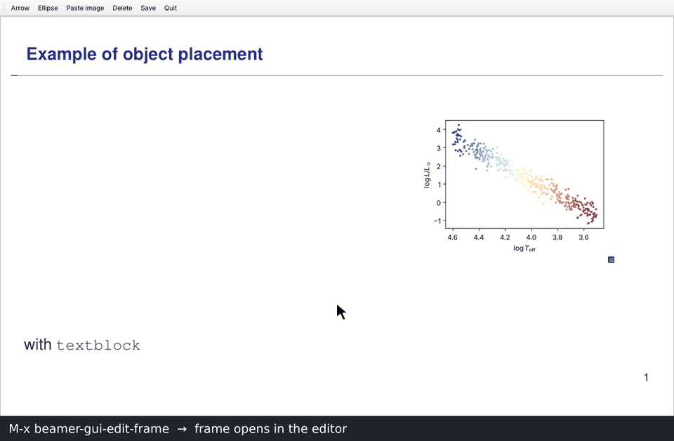

#+title: Emacs GUI editor for LaTeX beamer
#+author: Mathieu Renzo w/ Claude:Opus 5

I use emacs + Latex beamer to make pdf presentations. See [[https://github.com/mathren/beamer_template_mrenzo][here]] for a
template and my [[https://lavinia.as.arizona.edu/~mrenzo/talks.html][talks page]] for concrete eamples.

I wanted to be able to spawn a GUI to move elements and add arrows,
this package allows to do that.

#+CAPTION: Example of GUI usage

